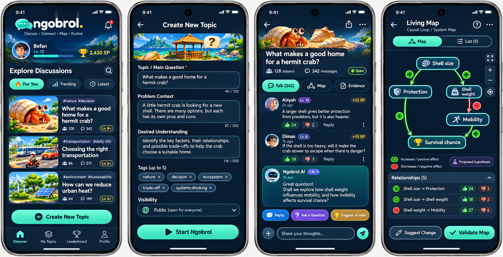

# Ngobrol visual references
These are original AI-generated concept images produced during product exploration. They are not screenshots of a running app or binding UI specifications. Written design and tested implementation take precedence.

| Asset | Purpose |
|---|---|
| [01_Core_Gameplay.png](01_Core_Gameplay.png) | primary four-screen design |
| [02_Discover.png](02_Discover.png) | discovery |
| [03_Create_Topic.png](03_Create_Topic.png) | create topic |
| [04_Discussion.png](04_Discussion.png) | Talk |
| [05_Living_Map.png](05_Living_Map.png) | map |
| [06_Extended_Experience_Concept.png](06_Extended_Experience_Concept.png) | onboarding, review, evidence, insights |
| [07_Game_Experience_Concept.png](07_Game_Experience_Concept.png) | rewards, profile and world exploration |
| [08_Game_Poster.png](08_Game_Poster.png) | promotional concept |

Original design folder: https://drive.google.com/drive/folders/1X8HiRDzD8K8hbR-iZ8gqPND2S7Ic__rF
Historical [Product and Game Design v0.1 DOCX](https://docs.google.com/document/d/1CqciXd-t3A1BbsuZE9UbVLZ9sOfnOUka/edit?usp=drivesdk&ouid=109927913709329387310&rtpof=true&sd=true). Drive access may be restricted. No Drive access is needed for repo handover. Earlier proposed React/Node architecture superseded by Flutter + Supabase. The images are exploratory; illustrative sample counts, names, polarity and XP can differ from requirements.
